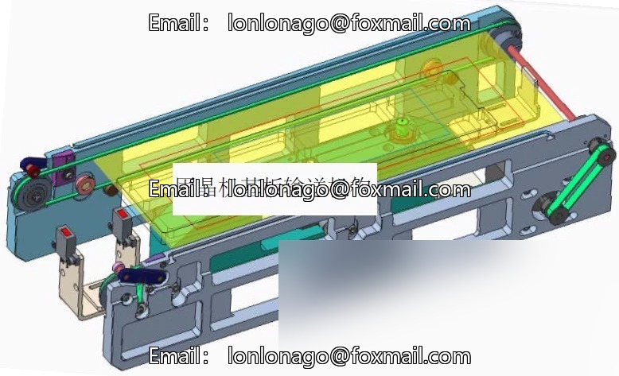

# Solid crystal machine substrate conveyance mechanism

## Body

Crystal Plate Transport Mechanism of the Solid Crystal Machine

It has detail, and thus has great reference value

Creo 3.0 parts and assembly models (asm and prt, stp)
Editable

will directly take it down and leave their email, no response to details consultation, thank you.

Products not sold are non-refundable, technical support is not provided

The image shows details of the solid-crystal machine substrate transfer mechanism, noting its significant reference value.

<!-- AI_ENRICHED -->

## Images

## Payment

Here is a pay link on Stripe ( https://buy.stripe.com/3cs8yP7sY87d0vu9AB ). Please contact me lonlonago@foxmail.com after funding $89, and I will send you a complete data files , thank you!

